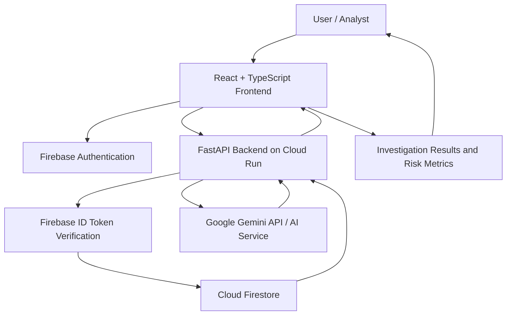

# REGALIS AI
### AI-Powered Regulatory Reporting & Risk Intelligence

**Turning regulatory reporting anomalies into actionable risk intelligence.**

REGALIS AI is an AI-powered regulatory reporting and risk intelligence platform designed to help financial institutions identify anomalous reporting metrics, investigate potential root causes, and understand risk signals through an intuitive, enterprise-focused dashboard.

By combining a modern web interface, cloud-based data services, and generative AI, REGALIS AI aims to make regulatory risk investigation more accessible, explainable, and efficient.

<p align="center">
  <a href="https://regalis-ai-4f46e.web.app">
    <strong>Live Demo</strong>
  </a>
  &nbsp; | &nbsp;
  <a href="#architecture">
    Architecture
  </a>
  &nbsp; | &nbsp;
  <a href="#getting-started">
    Getting Started
  </a>
</p>

---

## Table of Contents

- [Overview](#overview)
- [Problem Statement](#problem-statement)
- [Solution](#solution)
- [Key Features](#key-features)
- [Application Workflow](#application-workflow)
- [Technology Stack](#technology-stack)
- [Architecture](#architecture)
- [Live Demo](#live-demo)
- [API Overview](#api-overview)
- [Getting Started](#getting-started)
- [Environment Configuration](#environment-configuration)
- [Deployment](#deployment)
- [Security Considerations](#security-considerations)
- [Current Scope and Limitations](#current-scope-and-limitations)
- [Future Enhancements](#future-enhancements)
- [Contributing](#contributing)
- [License](#license)

---

## Overview

Regulatory reporting is a critical responsibility for financial institutions. Reporting anomalies, unexpected changes in risk metrics, and inconsistencies across reporting periods can require significant investigation before their causes and implications are understood.

REGALIS AI provides a centralized interface for reviewing reporting metrics, identifying anomalous changes, and initiating AI-assisted root-cause investigations.

The platform combines:

- A React-based enterprise dashboard.
- Firebase Authentication for Google sign-in.
- A FastAPI backend for report retrieval and investigation requests.
- Cloud Firestore for report and metric data.
- Google Cloud Run for backend hosting.
- Google Gemini integration for AI-assisted analysis.

The goal is to support human decision-making by making unusual reporting patterns easier to identify, investigate, and review.

## Problem Statement

Financial institutions work with large volumes of regulatory reporting data. Investigating unexpected metric movements can involve reviewing historical values, identifying anomalies, gathering evidence, and understanding possible contributing factors.

Common challenges include:

- Detecting significant changes in reporting metrics.
- Understanding why a metric has changed between reporting periods.
- Reducing repetitive manual investigation.
- Presenting risk signals in a format that analysts can understand quickly.
- Maintaining a clear distinction between automated analysis and human review.

## Solution

REGALIS AI brings reporting metrics and AI-assisted investigation into a unified workspace.

The application retrieves report metrics, presents available anomaly indicators, and allows users to initiate a root-cause analysis through the existing backend workflow.

AI-generated findings are intended to assist analysts rather than replace professional judgment. Findings should be validated against authoritative source data before they are used in actual regulatory or business decisions.

## Key Features

### 1. Secure User Authentication

- Google sign-in using Firebase Authentication.
- Authentication-state handling in the frontend.
- Firebase ID tokens attached to authenticated API requests.
- Backend token verification before protected operations.

### 2. Regulatory Report Overview

- Report identification and reporting-period context.
- Report status presentation.
- Centralized access to available report metrics.

### 3. Risk Metrics and Anomaly Indicators

- Presentation of available current and previous metric values.
- Display of percentage changes when supplied by the application.
- Visual indicators for metrics identified as anomalous.
- A dashboard designed to make important changes easier to review.

### 4. AI-Assisted Root Cause Analysis

- Initiation of investigations through the backend API.
- Integration with Google Gemini for AI-assisted analysis.
- Presentation of investigation responses in the frontend.
- Support for reviewing findings and identifying areas requiring further validation.

The conclusions produced depend on the information available to the application and the successful execution of the AI service.

### 5. Cloud-Based Architecture

- React frontend deployed using Firebase Hosting.
- FastAPI backend deployed using Google Cloud Run.
- Firestore integration for report and metric data.
- Firebase Authentication for identity verification.

### 6. Enterprise-Oriented User Experience

- Banking-focused visual design.
- Clear presentation of risk and investigation status.
- Structured report and metric views.
- Responsive layouts for supported screen sizes.

---

## Application Workflow

The application follows this general workflow:

1. **Authenticate:** The user signs in using Google.
2. **Access reports:** The frontend requests available report information.
3. **Review metrics:** The application retrieves and presents the metrics associated with a report.
4. **Identify anomalies:** Existing anomaly indicators help highlight unusual metric movements.
5. **Initiate investigation:** The user starts the Root Cause Analysis workflow.
6. **Generate analysis:** The backend processes the request and invokes the configured AI integration.
7. **Review findings:** The frontend displays the returned investigation results for human evaluation.

The frontend and backend communicate through HTTP APIs. Firebase ID tokens are used to authenticate requests where required.

---

## Technology Stack

| Layer | Technologies |
|---|---|
| Frontend | React, TypeScript, Vite |
| Styling | Existing project CSS and Tailwind styling where configured |
| Authentication | Firebase Authentication, Google Sign-In |
| Backend | Python, FastAPI |
| Database | Cloud Firestore |
| AI integration | Google Gemini, configured with `gemini-2.5-flash` |
| Frontend hosting | Firebase Hosting |
| Backend hosting | Google Cloud Run |
| Cloud platform | Google Cloud |
| Build and validation | TypeScript, Vite production build |

---

## Architecture



### Architecture Components

**Frontend — React and TypeScript**

Provides the user interface for authentication, report review, metric visualization, and root-cause investigation.

**Authentication — Firebase Authentication**

Supports Google sign-in and supplies Firebase ID tokens used by the frontend when communicating with the backend.

**Backend — FastAPI**

Handles report-related API requests, metric retrieval, and investigation requests.

**Database — Cloud Firestore**

Stores and serves report and metric data used by the application.

**AI Service — Google Gemini**

Provides the configured generative AI capability for investigation analysis.

**Hosting — Firebase Hosting and Google Cloud Run**

Firebase Hosting serves the frontend, while Cloud Run hosts the backend API.

---

## Live Demo

| Component | URL |
|---|---|
| REGALIS AI frontend | https://regalis-ai-4f46e.web.app |
| Backend service | https://regalis-ai-backend-526000967059.us-central1.run.app |

The frontend and backend are deployed independently. Updating the GitHub repository does not automatically update either deployment unless a deployment workflow has been configured.

---

## API Overview

The backend exposes the following application endpoints.

| Method | Endpoint | Purpose |
|---|---|---|
| `GET` | `/health` | Health check |
| `GET` | `/api/reports/{id}` | Retrieve a report |
| `GET` | `/api/reports/{id}/metrics` | Retrieve metrics for a report |
| `POST` | `/api/investigations/{id}` | Initiate or process a root-cause investigation |

These descriptions summarize the intended endpoint roles. Refer to the backend implementation for the exact request payloads, response schemas, authentication requirements, and error behavior.

For example, the current demonstration report uses the identifier:

`rep_credit_risk_2026_09`

Do not assume this identifier represents a live report from a real financial institution.

---

## Getting Started

### Prerequisites

Install or prepare the following:

- Git
- Node.js and npm, using versions compatible with the frontend project
- Python, using the version supported by the backend project
- Access to a Firebase project
- Access to a Google Cloud project for backend deployment
- Appropriate Google Cloud and Gemini permissions if running the real AI integration

### 1. Clone the Repository

Replace the example repository URL with your actual GitHub repository URL.

```bash
git clone https://github.com/YOUR_USERNAME/YOUR_REPOSITORY.git
cd YOUR_REPOSITORY
```

### 2. Set Up the Frontend

Navigate to the frontend directory:

```bash
cd frontend
```

Install the project dependencies:

```bash
npm install
```

Create a local environment file using the environment-variable names already defined by your frontend configuration.

```bash
touch .env.local
```

Configure the Firebase web application values and backend API base URL. See [Environment Configuration](#environment-configuration).

Start the development server:

```bash
npm run dev
```

Vite will print the local URL in the terminal. Open that URL in your browser.

To create a production build:

```bash
npm run build
```

The generated production files are normally written to `frontend/dist/`.

### 3. Set Up the Backend

From the repository root, navigate to the backend directory:

```bash
cd backend
```

Create and activate a Python virtual environment.

On Linux:

```bash
python3 -m venv .venv
source .venv/bin/activate
```

Install the backend dependencies using the dependency file included in the repository. For example, if the project contains `requirements.txt`:

```bash
pip install -r requirements.txt
```

Configure the required backend environment variables and cloud credentials using the actual backend configuration.

Start the API using the FastAPI application entry point defined in the repository. A typical command, if the entry point is `app.main:app`, is:

```bash
uvicorn app.main:app --reload
```

If the application entry point or dependency file has a different name, use the one present in the project.

---

## Environment Configuration

Never commit actual secrets or private credentials to GitHub.

### Frontend

The frontend uses Vite environment variables. Based on the current configuration, the application needs Firebase web configuration values and the backend API base URL.

Typical variable names include:

```dotenv
VITE_API_BASE_URL=
VITE_FIREBASE_API_KEY=
VITE_FIREBASE_AUTH_DOMAIN=
VITE_FIREBASE_PROJECT_ID=
VITE_FIREBASE_STORAGE_BUCKET=
VITE_FIREBASE_MESSAGING_SENDER_ID=
VITE_FIREBASE_APP_ID=
```

Use the exact variable names referenced by the existing Firebase initialization file. If your current implementation uses a different set, follow the source code rather than adding unnecessary variables.

The frontend's Firebase project ID is `regalis-ai-4f46e`.

### Backend

The deployed backend currently uses the following configuration:

| Variable | Purpose |
|---|---|
| `ENVIRONMENT` | Application environment |
| `AI_MODE` | AI service mode |
| `PROJECT_ID` | Google Cloud project ID |
| `REGION` | Google Cloud region |
| `GEMINI_MODEL` | Configured Gemini model |
| `FIREBASE_PROJECT_ID` | Firebase project used for authentication |

The current deployed configuration uses `AI_MODE=prod`, `GEMINI_MODEL=gemini-2.5-flash`, and region `us-central1`.

The Cloud Run project and Firebase project are separate:

- Google Cloud project: `regalis-ai-511412`
- Firebase project: `regalis-ai-4f46e`

Configure credentials and access using the relevant Google Cloud and Firebase mechanisms. Do not place service-account private keys or other server-side secrets in frontend environment variables.

---

## Deployment

### Frontend Deployment — Firebase Hosting

From the frontend directory, build the application:

```bash
npm run build
```

Deploy the frontend to the intended Firebase project:

```bash
npx firebase-tools deploy --only hosting --project regalis-ai-4f46e
```

Ensure the Firebase CLI is authenticated and that the existing Firebase Hosting configuration points to the correct build directory.

### Backend Deployment — Google Cloud Run

The backend is hosted on Google Cloud Run.

Deployment requires the appropriate Google Cloud project, region, service configuration, permissions, environment variables, and authentication setup.

The current service uses:

- Cloud Run service: `regalis-ai-backend`
- Region: `us-central1`
- Google Cloud project: `regalis-ai-511412`

Use the deployment configuration and instructions maintained in the repository. Do not assume that frontend deployment also deploys the backend.

---

## Security Considerations

REGALIS AI incorporates authentication and cloud-based access patterns, but authentication alone does not establish complete application security.

Important considerations include:

- Validate Firebase ID tokens on the backend for protected endpoints.
- Enforce appropriate authorization checks on report and investigation access.
- Apply least-privilege IAM permissions to cloud service accounts.
- Configure Firestore Security Rules according to the application's access model.
- Keep private API credentials and service-account keys out of the repository.
- Use HTTPS for deployed application traffic.
- Avoid logging tokens, secrets, or sensitive financial information.
- Validate inputs and handle errors safely.
- Review AI-generated outputs before using them in business or regulatory decisions.
- Use synthetic or properly authorized data for demonstrations and testing.

**REGALIS AI is a hackathon project and should not be assumed to be certified, production-approved, or compliant with any specific financial regulation.** A production banking deployment would require additional security, privacy, auditability, resilience, governance, and regulatory reviews.

---

## Current Scope and Limitations

The current implementation demonstrates the core workflow for report retrieval, metric presentation, anomaly indicators, and AI-assisted root-cause investigation.

The demonstration includes synthetic credit-risk reporting data, including the example report `rep_credit_risk_2026_09`.

The availability and quality of AI-generated findings depend on the configured AI service, available data, and backend implementation.

The platform should be evaluated against the actual implemented code and deployed configuration. Features not present in the repository should not be assumed to be implemented.

---

## Future Enhancements

Potential directions for future development include:

- Additional regulatory reporting formats and report types.
- More comprehensive historical trend analysis.
- Evidence-linked investigation results.
- Human review and approval workflows.
- Investigation audit trails and version history.
- Role-based access controls.
- Improved observability and operational monitoring.
- Automated testing and continuous integration.
- Expanded evaluation of AI-generated findings.
- Integration with authorized enterprise data sources.

These are potential enhancements, not claims about current functionality.

---

## Contributing

Contributions, suggestions, and feedback are welcome.

1. Fork the repository.
2. Create a feature branch.
3. Make focused changes.
4. Run the existing tests and production build.
5. Submit a pull request describing the changes.

Please avoid including confidential information, private credentials, or unauthorized financial data in contributions.

---

## License

No license has been specified yet.

Before making the repository public, choose an appropriate license and add a corresponding `LICENSE` file. If you intend to retain all rights, do not add an open-source license without deciding to do so.

---

<p align="center">
  <strong>REGALIS AI</strong><br/>
  Intelligent investigation. Clearer risk insights. Better-informed decisions.
</p>
